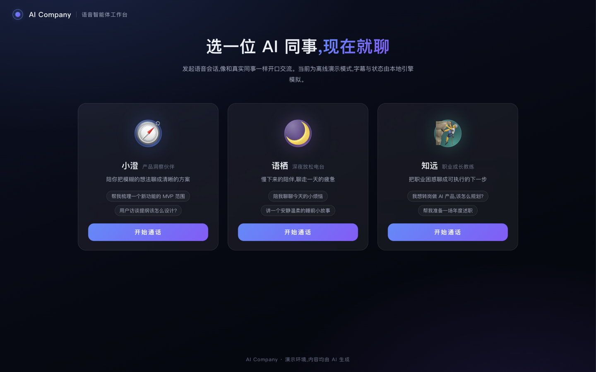

# AI Company · 语音智能体工作台

在浏览器里与一组「AI 同事」实时语音对话:选一个人设,发起通话,开口即聊。字幕、打断、通话计时、多设备适配开箱即用;语音传输、会话编排与大脑生成全部基于可插拔接口,内置离线 mock 实现,克隆即可运行。



## 架构

```
┌─────────────┐   HTTP/JSON    ┌─────────────┐    HTTP/SSE    ┌──────────────┐
│  web (5173)  │ ─────────────▶ │ server(8790) │               │ ai-service   │
│  React SPA   │                │  Express 网关 │               │  (8900)      │
│  rtc 引擎抽象 │ ◀──mock 事件─── │ providers 缝口│ ◀─────────────│  FastAPI     │
└─────────────┘                 └─────────────┘                └──────────────┘
```

| 目录 | 职责 | 技术栈 |
| --- | --- | --- |
| `web/` | 人设画廊、语音房间、字幕与控制条 | React 18 · TypeScript · Vite · Redux Toolkit |
| `server/` | 人设配置下发、语音会话生命周期 | Node.js 18+ · Express |
| `ai-service/` | 人设化对话生成、知识检索、流式输出 | Python · FastAPI |

三个可插拔缝口(全部内置 mock,接入真实供应商零业务改动):

| 缝口 | 位置 | 指南 |
| --- | --- | --- |
| 语音引擎 VoiceEngine | `web/src/rtc/` | [web/src/rtc/README.md](web/src/rtc/README.md) |
| 会话提供方 AgentProvider | `server/src/providers/` | [server/src/providers/README.md](server/src/providers/README.md) |
| 大脑 LLM / 检索 Retriever | `ai-service/app/providers/` | [docs/provider-integration.md](docs/provider-integration.md) |

## 快速开始

要求:Node 18+、Python 3.11+ 与 [uv](https://docs.astral.sh/uv/)。开三个终端:

```bash
# 1. 会话网关(http://localhost:8790)
cd server && npm install && npm start

# 2. 大脑服务(http://localhost:8900)
cd ai-service && uv sync && uv run uvicorn app.main:app --port 8900

# 3. 前端(http://localhost:5173)
cd web && npm install && npm run dev
```

打开 http://localhost:5173 :选一个人设 → 开始通话 → 在「演示输入」里打字即可驱动一轮完整对话(离线演示模式下,文字输入模拟开口说话)。

## 新增一个人设

只需两处配置,不改代码:

1. `server/scenes/` 新增 JSON(名字、头像、问候语、快捷问题、能力开关;`systemPrompt`/`voice`/`llm` 为服务端私有字段)
2. `ai-service/app/personas.py` 同步补一条语体档案(mock 大脑的回复风格)

## 环境变量

复制各服务的 `.env.example` 为 `.env`(web 为 `.env.local`)后按需修改;所有变量默认值都可在离线模式下工作,任何密钥一律留空且只放在服务端。

| 变量 | 位置 | 说明 |
| --- | --- | --- |
| `AGENT_PROVIDER` | server | 会话提供方,默认 `mock` |
| `MOCK_SIGNING_SECRET` | server | mock 凭据签名密钥,生产必须更换 |
| `LLM_BASE_URL` / `LLM_API_KEY` / `LLM_MODEL` | ai-service | 设置后大脑切换为 OpenAI 兼容接口 |
| `VITE_VOICE_PROVIDER` | web | 语音引擎,默认 `mock` |

## 验证

```bash
cd server && npm run smoke        # 场景下发 + 会话创建/结束全链路
cd web && npm run build           # 类型检查 + 构建
```

## 文档

- 产品范围与验收标准:[spec/](spec/README.md)
- 供应商接入(含接入后验收清单):[docs/provider-integration.md](docs/provider-integration.md)
- 面向智能体的协作约定:[AGENTS.md](AGENTS.md)
